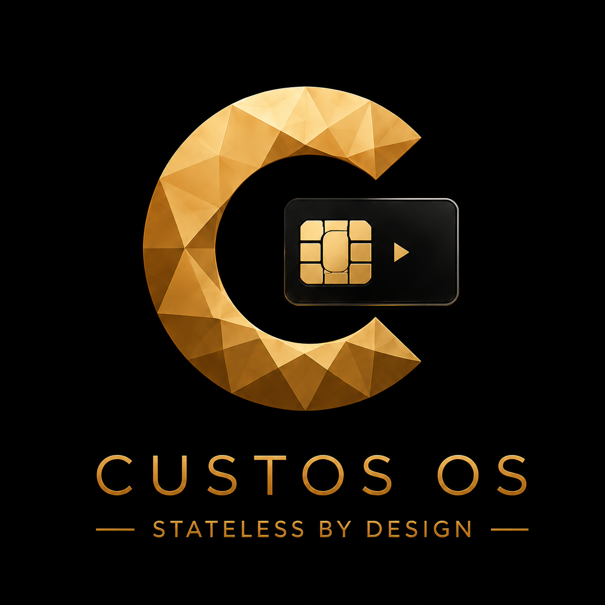

<p align="center">
  
</p>
<h1 align="center">Custos OS</h1>
<p align="center"><b>Stateless by design.</b><br/>
An air-gapped bitcoin signer that keeps your seed on a PIN-protected SeedKeeper
smartcard, and remembers nothing once it powers off.</p>
<p align="center"><a href="https://custos-os.com">custos-os.com</a></p>

---

Custos OS is [SeedSigner](https://seedsigner.com) with SeedKeeper smartcard
support. Insert the card in a SEC1210 HAT or hold it to a PN532 NFC reader, enter
your PIN, and the seed is read straight into memory to sign. Pull the power and it
is gone. Everything outside the smartcard code is stock SeedSigner, on purpose.

> **v0.1 is a beta.** It runs on a Raspberry Pi Zero v1.3 and has been tested on
> real hardware. Keep a second backup of any seed you put on a card.

## Repositories

| Repo | What |
|---|---|
| **custos-os** (this one) | Release images, build scripts, verifiers, branding |
| [custos-seedsigner](https://github.com/xmrstreetstore/custos-seedsigner) | The app: fork of SeedSigner with the smartcard features |
| [custos-seedsigner-os](https://github.com/xmrstreetstore/custos-seedsigner-os) | The OS: fork of SeedSigner OS with the smartcard stack |

Clone with submodules:

```bash
git clone --recurse-submodules https://github.com/xmrstreetstore/custos-os.git
```

## What it adds to SeedSigner

- **Load a seed from a SeedKeeper card.** If the card also holds a passphrase, you
  choose whether to use it.
- **Save a seed to a card,** labelled with its fingerprint and read back to check
  the write. A BIP-39 passphrase is saved with the seed; the confirm screen says so.
- **Contact or NFC,** with a live connection bar for a tapped card.
- **Full-keyboard PIN,** 4–16 characters, masked on screen.
- **Five strikes:** each wrong PIN shows the attempts left, and a card set up on
  Custos wipes itself after the fifth.
- **Card setup:** install or remove the SeedKeeper applet (bundled, hash-checked)
  and set a new card's PIN.
- **Reader selection:** switch either reader off in Settings › Hardware.

## Hardware

- Raspberry Pi Zero v1.3 (no Wi-Fi or Bluetooth on the board)
- SEC1210 smartcard HAT, and/or a PN532 NFC reader on I2C
- 2.8" 320×240 display (the 1.3" 240×240 SeedSigner panel also works) and a Pi camera
- A JavaCard running the SeedKeeper applet (e.g. J3H145, J3R180). Custos can install
  the applet itself.

Parts are available from [xmrstreet.store](https://xmrstreet.store/product-category/smartcards-and-seedkeeper/).

## Install

1. Download `custos.pi0.img` and `SHA256SUMS` from the
   [latest release](https://github.com/xmrstreetstore/custos-os/releases).
2. Check the image:
   ```bash
   sha256sum -c SHA256SUMS
   ```
   On Windows: `Get-FileHash custos.pi0.img` and compare with `SHA256SUMS`.
3. Flash it to a microSD card with Raspberry Pi Imager or balenaEtcher, put it in the
   Pi Zero and power on.

## Security model

- **Nothing on the device.** Seeds exist only in RAM while the signer is on.
- **No network.** Wi-Fi and Bluetooth are disabled in the build, no radio drivers or
  Broadcom firmware are included (`build/verify.sh` fails if any appear), and the
  Pi Zero v1.3 has no wireless chip. Transactions move by QR code.
- **NFC is the one RF link:** a few centimetres, card only, and optional.
- **Card state, not guesses.** Every card operation is confirmed by asking the card;
  if it cannot be confirmed, Custos says so instead of showing success.

## Building from source

The build runs the stock SeedSigner OS buildroot inside a Docker volume. The steps,
and the pitfalls, are in [build/README.md](build/README.md):

| Script | Does |
|---|---|
| `build/stage.sh` | Copies both repos into the `ssbuild` volume |
| `build/build-pi0.sh` | Builds the release pi0 image (`build-pi0-dev.sh`, `build-pi4-dev.sh` for dev images with SSH) |
| `build/verify.sh` | Checks the built rootfs: smartcard stack, reader config, applet hashes, no radio firmware |
| `build/verify-img.sh` | Reads `config.txt` from the finished `.img` itself |
| `build/verify-app.sh` | Checks the smartcard features landed in the rootfs |
| `build/verify-imports.sh` | Imports every module with the target's own ARM Python under qemu |
| `build/verify-crypto.sh` | Checks the crypto primitives against published test vectors, on the target |
| `build/verify-reader.sh` | Checks pcscd can actually reach the readers, not just that it is installed (needs `--privileged`) |
| `build/verify-seed-layout.sh` | Writes a seed the way the card stores it and reads it back, under qemu (needs `--privileged`) |
| `build/verify-game.sh` | Only for the separate combined image with the Orange Kingdom game; not used for Custos releases |

`PLAN.md` is the original porting plan, kept for history. Some of it (SEC1210 only,
no NFC) has since changed.

## Licence and credits

Build scripts and docs in this repo: MIT, see [LICENSE](LICENSE). The app and OS
forks are MIT, like SeedSigner. The bundled SeedKeeper applet is Satochip's work,
licensed AGPL-3.0; its source is the
[`v0.2-0.1` tag of Toporin/Seedkeeper-Applet](https://github.com/Toporin/Seedkeeper-Applet/tree/v0.2-0.1).

Built on [SeedSigner](https://github.com/SeedSigner/seedsigner) and
[SeedSigner OS](https://github.com/SeedSigner/seedsigner-os). Smartcard support
ported from [3rdIteration's fork](https://github.com/3rdIteration/seedsigner).
SeedKeeper by [Satochip](https://satochip.io).

Custos OS is an independent project, not affiliated with SeedSigner or Satochip.
