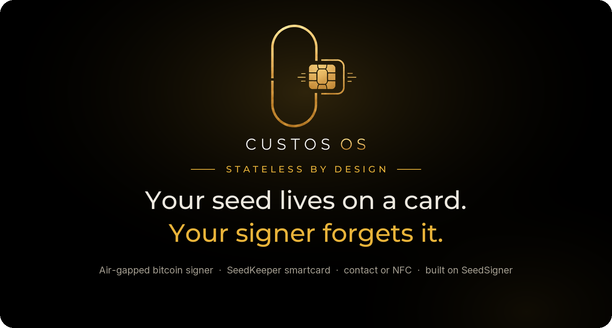
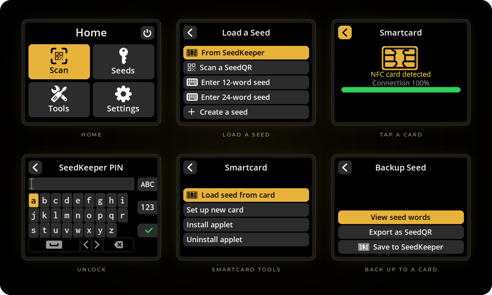

<p align="center">
  <a href="https://custos-os.com"></a>
</p>

<p align="center">
  <b><a href="https://custos-os.com">custos-os.com</a></b> &nbsp;·&nbsp;
  <a href="#install">Install</a> &nbsp;·&nbsp;
  <a href="#how-it-works">How it works</a> &nbsp;·&nbsp;
  <a href="#security-model">Security</a> &nbsp;·&nbsp;
  <a href="#hardware">Hardware</a> &nbsp;·&nbsp;
  <a href="#building-from-source">Build</a>
</p>

---

**Custos OS is an air-gapped bitcoin signer built on [SeedSigner](https://seedsigner.com).**
It reads your seed from a PIN-protected SeedKeeper smartcard, by contact or NFC,
signs your transaction, and keeps nothing once it powers off. Everything else is
stock SeedSigner, on purpose.

> [!NOTE]
> **v0.1 is a beta.** It runs on a Raspberry Pi Zero v1.3 and has been tested on real
> hardware. Keep a second backup of any seed you put on a card.

<p align="center">
  
</p>
<p align="center"><sub>Rendered from the Custos OS source at the device's 320×240 resolution.</sub></p>

## What it adds

SeedSigner never stores your seed, so you bring it every time: as words, as a
SeedQR, or with Custos, on a SeedKeeper card that only opens with your PIN.

| Feature | What it does |
|---|---|
| **Load a seed from a card** | 12 or 24 words go straight into memory. If the card also holds a passphrase, you choose whether to use it. Nothing is written to the device. |
| **Save a seed to a card** | Labelled with its fingerprint, and read back to check the write. A BIP-39 passphrase is saved with the seed; the confirm screen says so. |
| **Insert it or tap it** | SEC1210 contact slot or PN532 NFC reader. A live connection bar shows when a tapped card is steady enough to use. |
| **A real PIN** | 4–16 characters on a full keyboard, letters and symbols included, masked on screen. |
| **Five strikes** | Each wrong PIN shows the tries left. A card set up on Custos wipes itself after the fifth. |
| **Set up your own cards** | Install or remove the SeedKeeper applet from a file bundled in the image and checked against the upstream hash, and set a new card's PIN. Nothing is downloaded. |

## How it works

1. **Power on.** The signer boots its image into RAM, with no network and no seed.
2. **Present your card.** Pick *From SeedKeeper*, then insert the card or hold it to the reader.
3. **Unlock and choose.** Enter your PIN, pick the seed, check its fingerprint against your wallet.
4. **Scan, sign, power off.** Scan the transaction QR, review it, show the signed QR back. Pull the power and the seed is gone.

Wallets: the same as stock SeedSigner, through QR-code PSBTs — Sparrow, Nunchuk,
Specter Desktop, BlueWallet and others.

## Security model

- **Nothing on the device.** Seeds exist only in RAM while the signer is on.
- **No network, ever.** Wi-Fi and Bluetooth are disabled in the build, no radio drivers
  or Broadcom firmware are included (`build/verify.sh` fails if any appear), and the
  Pi Zero v1.3 has no wireless chip. Transactions move by QR code.
- **NFC, honestly.** It is the one RF link: a few centimetres, card only, and optional.
  Switch it off under Settings › Hardware › Smartcard interfaces, or don't fit it.
- **A small, reviewable change.** Only the card features were ported onto stock
  SeedSigner, rather than adopting a fork hundreds of commits ahead.
- **Card state, not guesses.** Every card operation is confirmed by asking the card.
  If it cannot be confirmed, Custos says so instead of showing success.
- **Can't brick your card.** Uninstall only offers Satochip-family applets.

## Hardware

| Part | Notes |
|---|---|
| **Raspberry Pi Zero v1.3** | The board without Wi-Fi or Bluetooth |
| **SEC1210 smartcard HAT** | Contact reader — [Smartcard HAT](https://xmrstreet.store/product/smartcard-hat-for-seedsigner/) · [Plus smartcard hat](https://xmrstreet.store/product/smartcard-combo-pcb-hat/) |
| **PN532 NFC reader** | Optional, on I2C |
| **2.8″ 320×240 display + Pi camera** | The 1.3″ 240×240 SeedSigner panel also works |
| **A SeedKeeper card** | Any JavaCard running the SeedKeeper applet, e.g. J3H145 or J3R180 — [Smartcards & SeedKeeper](https://xmrstreet.store/product-category/smartcards-and-seedkeeper/) |

## Install

### 1. Download

From the [latest release](https://github.com/xmrstreetstore/custos-os/releases),
download all three files:

- `custos.pi0.img` — the image
- `SHA256SUMS` — its checksum
- `SHA256SUMS.asc` — the checksum, signed with the xmrstreetstore key

### 2. Verify the signature

This proves the checksum file was made by us and not swapped along with the image.

Import the signing key. It is the same key in all of these places, so get it from
one and compare the fingerprint with another:
[`keys/xmrstreetstore.asc`](keys/xmrstreetstore.asc) in this repo,
[github.com/xmrstreetstore.gpg](https://github.com/xmrstreetstore.gpg), and
[custos-os.com](https://custos-os.com).

```bash
curl -sL https://github.com/xmrstreetstore.gpg | gpg --import
gpg --verify SHA256SUMS.asc SHA256SUMS
```

You should see `Good signature from "xmrstreetstore <info@xmrstreet.store>"` and this
primary key fingerprint:

```
E8C0 F756 E611 3813 7DFF  39BE F1FD 97FD 5D2A AA2C
```

A warning that the key "is not certified with a trusted signature" is normal: it
only means you have not signed the key yourself. **Stop if the signature is BAD or
the fingerprint differs.**

### 3. Verify the image

```bash
sha256sum -c SHA256SUMS
```

It must print `custos.pi0.img: OK`. On Windows, `Get-FileHash custos.pi0.img` must
match the hash in `SHA256SUMS`. For the signature check on Windows, install
[Gpg4win](https://gpg4win.org) and run the same `gpg` commands, or open
`SHA256SUMS.asc` in Kleopatra.

### 4. Flash

Write the image to a microSD card with Raspberry Pi Imager or balenaEtcher, put it in
the Pi Zero and power on.

## Repositories

| Repo | What |
|---|---|
| **custos-os** (this one) | Release images, build scripts, verifiers, branding |
| [custos-seedsigner](https://github.com/xmrstreetstore/custos-seedsigner) | The app: fork of SeedSigner with the smartcard features |
| [custos-seedsigner-os](https://github.com/xmrstreetstore/custos-seedsigner-os) | The OS: fork of SeedSigner OS with the smartcard stack |

```bash
git clone --recurse-submodules https://github.com/xmrstreetstore/custos-os.git
```

On Windows, run `git config --global core.longpaths true` first: SeedSigner OS's
buildroot has paths longer than Windows allows by default.

## Building from source

The build runs the stock SeedSigner OS buildroot inside a Docker volume. The steps,
and the pitfalls, are in [build/README.md](build/README.md).

| Script | Does |
|---|---|
| `build/stage.sh` | Copies both repos into the `ssbuild` volume |
| `build/build-pi0.sh` | Builds the release pi0 image (`build-pi0-dev.sh`, `build-pi4-dev.sh` for dev images with SSH) |
| `build/verify.sh` | Checks the built rootfs: smartcard stack, reader config, applet hashes, no radio firmware |
| `build/verify-img.sh` | Reads `config.txt` from the finished `.img` itself |
| `build/verify-app.sh` | Checks the smartcard features landed in the rootfs |
| `build/verify-imports.sh` | Imports every module with the target's own ARM Python under qemu |
| `build/verify-crypto.sh` | Checks the crypto primitives against published test vectors, on the target |
| `build/verify-reader.sh` | Checks pcscd can actually reach the readers, not just that it is installed (needs `--privileged`) |
| `build/verify-seed-layout.sh` | Writes a seed the way the card stores it and reads it back, under qemu (needs `--privileged`) |
| `build/verify-game.sh` | Only for the separate combined image with the Orange Kingdom game; not used for Custos releases |

`PLAN.md` is the original porting plan, kept for history; some of it (SEC1210 only,
no NFC) has since changed. The README artwork is generated by
`branding/readme_art.py`.

## Licence and credits

Build scripts and docs in this repo: MIT, see [LICENSE](LICENSE). The app and OS
forks are MIT, like SeedSigner. The bundled SeedKeeper applet is Satochip's work,
licensed AGPL-3.0; its source is the
[`v0.2-0.1` tag of Toporin/Seedkeeper-Applet](https://github.com/Toporin/Seedkeeper-Applet/tree/v0.2-0.1).

Built on [SeedSigner](https://github.com/SeedSigner/seedsigner) and
[SeedSigner OS](https://github.com/SeedSigner/seedsigner-os). Smartcard support
ported from [3rdIteration's fork](https://github.com/3rdIteration/seedsigner).
SeedKeeper by [Satochip](https://satochip.io). Custos OS is an independent project,
not affiliated with SeedSigner or Satochip.

<p align="center">
  <br/>
  <a href="https://custos-os.com"></a>
  <br/>
  <sub><b>CUSTOS OS</b> · Stateless by design</sub>
</p>
